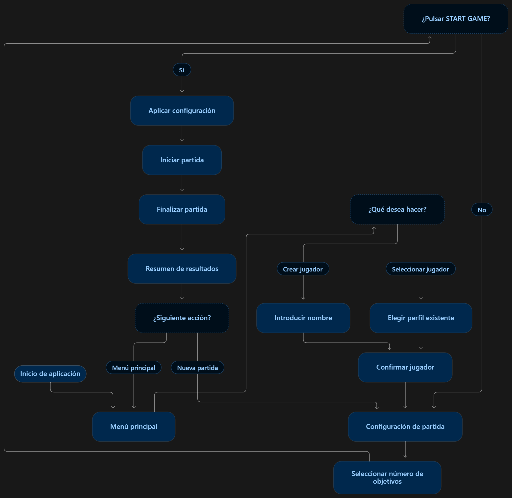

# Componente Unity

Este documento describe la evolución técnica del componente Unity de Aim Trainer Platform.

Su objetivo es mantener una referencia de la arquitectura, funcionamiento, versiones, pruebas y principales decisiones técnicas adoptadas durante el desarrollo.

## Información general

El componente Unity implementa el videojuego Aim Trainer encargado de generar las sesiones de juego (y, por conmsiguiente, los datos a analizar) que posteriormente serán utilizadas por el resto de la plataforma.

La versión del editor utilizada en el proyecto es:

```text
Unity 2020.3.33f1
```

La parte de desarrollo del componente se encuentra en:

```text
unity_game/AimTrainer
```

## Objetivo del componente

El juego debe permitir al usuario realizar sesiones de entrenamiento en las que aparecen objetos en la escena que tienen que ser eliminados haciendo click.

A lo largo de las distintas versiones, el componente incorporará progresivamente:

- ciclo básico de juego;
- navegación e interfaz;
- generación de objetivos;
- detección de impactos;
- tiempos de reacción;
- registro de clics;
- expiración de objetivos;
- telemetría de sesiones;
- exportación de datos;
- envío automático de sesiones al backend;
- distinción de grados de dificultad.

## Arquitectura actual

La lógica del juego se divide en diferentes scripts con responsabilidades separadas.

### `GameManager`

Gestiona el ciclo general de la partida.

Entre sus responsabilidades se encuentran:

- coordinar el comienzo de la partida;
- detectar la finalización;
- permitir reiniciar el juego.

Se encuentra en: `scripts/Core/GameManager.cs`

### `TargetManager`

Gestiona los objetivos que aparecen durante la partida.

Sus responsabilidades principales son:

- crear objetivos;
- calcula la posición aleatoria en la que aparecen los objetivos;
- controlar el número máximo de objetivos;
- mantener referencias a los objetivos activos;
- gestiona la eliminación de objetivos (por acierto o por tiempo de vida).

Se encuentra en: `scripts/GamePlay/TargetManager.cs`

### `Target`

Representa un objetivo individual.

Cada objetivo controla su propio tiempo de vida y puede finalizar de dos formas:

- acierto del usuario;
- expiración por superar el tiempo máximo permitido.

Se encuentra en: `scripts/GamePlay/Target.cs`

### `InputManager`

Gestiona la interacción del usuario.

Utiliza raycasting 3D para detectar si un clic se ha realizado sobre un objetivo.

Se encuentra en: `scripts/GamePlay/InputManager.cs`

## `GameSettings`

Contiene los cambios de ajustes que se puedan hacer desde el menú de juego (como el número máximo de objetivos por partida).

Se encuentra en: `scripts/Menus/GameSettings.cs`

## `MenuManager`

Gestiona la navegación entre las distintas pantallas de los menús y aplica los cambios de ajustes en el juego. 

Los menús que podemos encontrar son:

- Menú inicial del juego
- Registro de jugador
- Log in
- Ajustes básicos e inicio del juego

## Flujo básico de una partida

El flujo actual puede resumirse de la siguiente forma:



## Versiones

### Versión `unity-v0.1.0`

#### Objetivo

Disponer de una primera versión jugable y demostrable del Aim Trainer.

Esta versión corresponde al MVP del componente Unity.

#### Funcionalidades incluidas

- navegación inicial básica;
- acceso al juego desde un menú;
- generación de objetivos;
- interacción mediante clic;
- detección de impactos;
- expiración automática de objetivos;
- número máximo configurable de objetivos;
- finalización de la partida;
- posibilidad de iniciar una nueva sesión.

#### Funcionalidades no incluidas

Esta versión no incluye todavía:

- exportación de datos a JSON;
- gestión de usuarios y registro;
- telemetría completa de sesiones;
- backend;
- persistencia;
- conexión con la aplicación web;
- almacenamiento en base de datos.

Estas funcionalidades forman parte de iteraciones posteriores.

### Pruebas realizadas para `unity-v0.1.0`

Antes de considerar terminada la versión se comprueba:

#### Inicio del juego

- el proyecto se abre correctamente;
- no aparecen errores relevantes en consola;
- el menú inicial se muestra correctamente;
- el usuario puede acceder a la partida.

#### Ciclo de juego

- la partida comienza correctamente;
- los objetivos aparecen durante la sesión;
- los impactos son detectados;
- los objetivos desaparecen después de un acierto;
- los objetivos expiran si no son alcanzados;
- se generan nuevos objetivos durante la partida.

#### Finalización

- la sesión termina después del número configurado de objetivos;
- no se generan objetivos adicionales después del final;
- puede iniciarse una nueva partida;
- el estado de la partida anterior no afecta a la siguiente.

#### Configuración

- se prueban distintos valores de número máximo de objetivos;
- la partida respeta la configuración seleccionada.

#### Build ejecutable

Se genera una build ejecutable de la versión y se comprueba:

- inicio correcto de la aplicación;
- navegación hasta el juego;
- ejecución completa de una partida;
- finalización correcta;
- posibilidad de volver a jugar.

## Evidencias de la versión

Para cada versión estable del componente se recomienda conservar:

- tag Git asociado;
- build ejecutable;
- capturas de pantalla;
- pruebas realizadas;
- incidencias relevantes;
- fecha de validación.

Estas evidencias pueden utilizarse posteriormente para documentar la evolución del proyecto en la memoria y en la presentación del TFG.

## Próxima versión: `unity-v0.2.0`

La siguiente versión del componente estará centrada en la generación de telemetría y exportación de datos.

El objetivo previsto es registrar información de cada sesión, incluyendo:

- identificador de sesión;
- objetivos generados;
- resultado de cada objetivo;
- clics realizados;
- tiempos de reacción;
- expiraciones;
- posiciones relevantes.

Los datos se exportarán inicialmente mediante un archivo JSON que servirá como contrato de entrada para los componentes posteriores de análisis y backend.

## Evolución futura

Posteriormente el componente incorporará mejoras como:

- interfaz de usuario más completa;
- HUD durante la partida;
- feedback sonoro;
- ajustes de experiencia de usuario;
- integración directa con el backend;
- envío automático de sesiones.

## Criterio de mantenimiento de este documento

Este archivo debe actualizarse cuando una versión del componente Unity introduzca cambios relevantes en:

- arquitectura;
- flujo de juego;
- funcionalidades;
- datos generados;
- integración con otros componentes;
- pruebas o limitaciones.

No es necesario documentar cada commit individual.

La documentación debe mantenerse centrada en decisiones técnicas, versiones e incrementos funcionales relevantes.