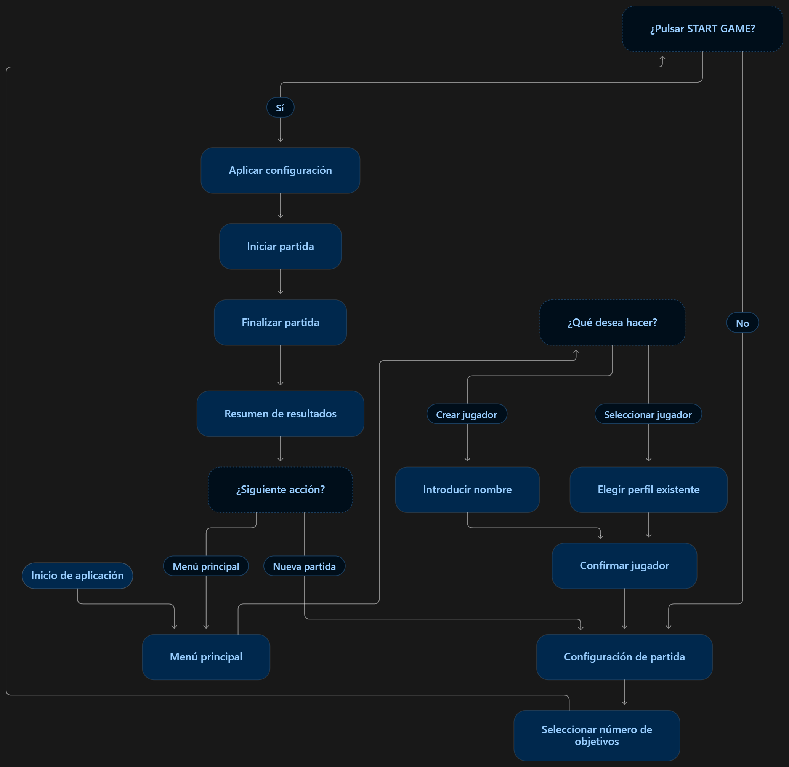

# Componente Unity

Este documento describe la evolución técnica del componente Unity de Aim Trainer Platform.

Su objetivo es mantener una referencia de la arquitectura, funcionamiento, versiones, pruebas y principales decisiones técnicas adoptadas durante el desarrollo.

## Información general

El componente Unity implementa el videojuego Aim Trainer encargado de generar las sesiones de juego y los datos que posteriormente serán utilizados por el resto de la plataforma para su análisis.

La versión del editor utilizada en el proyecto es:

```text
Unity 2020.3.33f1
```

La parte de desarrollo del componente se encuentra en:

```text
unity_game/AimTrainer
```

## Objetivo del componente

El juego debe permitir al usuario realizar sesiones de entrenamiento en las que aparecen objetivos en la escena que deben ser alcanzados mediante clic.

A lo largo de las distintas versiones, el componente incorporará progresivamente:

- ciclo básico de juego;
- navegación e interfaz;
- generación de objetivos;
- detección de impactos;
- tiempos de reacción;
- registro de clics;
- expiración de objetivos;
- telemetría de sesiones;
- exportación de datos;
- distintos parámetros de configuración;
- mejoras de interfaz y experiencia de usuario;
- integración con el backend;
- envío automático de sesiones.

## Arquitectura actual

La lógica del juego se divide en diferentes scripts con responsabilidades separadas.

### `GameManager`

Gestiona el ciclo general de la partida.

Entre sus responsabilidades se encuentran:

- coordinar el comienzo de la partida;
- aplicar la configuración seleccionada;
- iniciar el registro de una nueva sesión;
- detectar la finalización;
- finalizar el registro de datos;
- permitir iniciar nuevas partidas.

Se encuentra en:

```text
Scripts/Core/GameManager.cs
```

### `TargetManager`

Gestiona los objetivos que aparecen durante la partida.

Sus responsabilidades principales son:

- crear objetivos;
- calcular posiciones aleatorias de aparición;
- controlar el número máximo de objetivos;
- asignar un identificador a cada objetivo;
- mantener referencias a los objetivos activos;
- gestionar la eliminación de objetivos por acierto o expiración;
- comunicar los eventos relevantes al sistema de registro de sesión.

Se encuentra en:

```text
Scripts/GamePlay/TargetManager.cs
```

### `Target`

Representa un objetivo individual.

Cada objetivo mantiene su propio identificador y controla su tiempo de vida.

Puede finalizar de dos formas:

- acierto del usuario;
- expiración al superar el tiempo máximo permitido.

Se encuentra en:

```text
Scripts/GamePlay/Target.cs
```

### `InputManager`

Gestiona la interacción del usuario.

Utiliza raycasting 3D para detectar los clics realizados durante la partida.

Actualmente diferencia entre:

- clic sobre un objetivo;
- clic fallido.

Todos los clics realizados durante una sesión se comunican al sistema de registro para poder ser analizados posteriormente.

Se encuentra en:

```text
Scripts/GamePlay/InputManager.cs
```

### `SessionRecorder`

Gestiona la captura y exportación de los datos generados durante una partida.

Entre sus responsabilidades se encuentran:

- inicializar una nueva sesión;
- registrar los objetivos generados;
- registrar todos los clics realizados;
- registrar aciertos;
- registrar expiraciones;
- calcular tiempos relativos dentro de la sesión;
- calcular tiempos de reacción;
- completar los datos de cada objetivo;
- serializar la sesión;
- exportar los datos a un archivo JSON.

Los tiempos relativos se calculan utilizando un mismo reloj asociado al inicio de la sesión.

La serialización se realiza mediante:

```text
Newtonsoft.Json
```

Esto permite representar correctamente valores nulos como, por ejemplo, un tiempo de reacción inexistente en un objetivo que ha expirado.

Se encuentra en:

```text
Scripts/GamePlay/SessionRecorder.cs
```

### Clases de datos

La información de una sesión se representa mediante tres clases principales.

#### `SessionData`

Representa una partida completa.

Contiene información general de la sesión y las colecciones de objetivos y clics.

#### `TargetData`

Representa un objetivo generado durante una partida.

Registra:

- identificador;
- momento de aparición;
- momento de desaparición;
- posición;
- resultado;
- tiempo de reacción.

#### `ClickData`

Representa un clic realizado durante la sesión.

Registra:

- momento del clic;
- posición;
- si produjo un acierto;
- objetivo asociado, si existe.

Los clics fallidos utilizan:

```json
"targetId": null
```

al no estar relacionados con ningún objetivo.

### `GameSettings`

Contiene los ajustes configurables desde el menú de juego.

Actualmente permite modificar parámetros como el número máximo de objetivos de una partida.

Se encuentra en:

```text
Scripts/Menus/GameSettings.cs
```

### `MenuManager`

Gestiona la navegación entre las distintas pantallas de los menús y aplica los cambios de configuración correspondientes.

Los menús actuales incluyen:

- menú inicial;
- registro de jugador;
- inicio de sesión;
- configuración básica;
- acceso al juego.

## Flujo básico de una partida

El flujo actual puede resumirse de la siguiente forma:



A nivel de registro de datos, el flujo puede representarse como:

```text
StartGame
    ↓
StartSession
    ↓
SpawnTarget
    ↓
RegisterTarget
    ↓
Interacción del usuario
    ↓
RegisterClick
    ↓
Hit / Timeout
    ↓
RegisterHit / RegisterTimeout
    ↓
Fin de la partida
    ↓
EndSession
    ↓
Exportación JSON
```

## Contrato de datos actual

Las sesiones generadas por Unity utilizan actualmente la versión:

```text
schemaVersion 1.0
```

La estructura general es:

```text
SessionData
│
├── schemaVersion
├── sessionId
├── playerId
├── timestamp
├── maxTargets
├── targetLifetimeSeconds
│
├── targets[]
│   ├── targetId
│   ├── spawnTimeMs
│   ├── despawnTimeMs
│   ├── targetX
│   ├── targetY
│   ├── result
│   └── reactionTimeMs
│
└── clicks[]
    ├── timeMs
    ├── posX
    ├── posY
    ├── hit
    └── targetId
```

Las posiciones de objetivos y clics se almacenan mediante coordenadas normalizadas.

Esto permite trabajar con valores independientes de la resolución de pantalla y facilita análisis posteriores como:

- mapas de calor;
- distribución espacial de errores;
- comparación entre posición del objetivo y posición del clic.

Las posiciones utilizan valores normalizados aproximadamente entre:

```text
0.0 y 1.0
```

tanto en el eje X como en el eje Y.

## Versiones

### Versión `unity-v0.1.0`

#### Objetivo

Disponer de una primera versión jugable y demostrable del Aim Trainer.

Esta versión corresponde al MVP inicial del componente Unity.

#### Funcionalidades incluidas

- navegación inicial básica;
- acceso al juego desde un menú;
- generación de objetivos;
- interacción mediante clic;
- detección de impactos;
- expiración automática de objetivos;
- número máximo configurable de objetivos;
- finalización de la partida;
- posibilidad de iniciar una nueva sesión.

#### Funcionalidades no incluidas

Esta versión no incluía todavía:

- exportación de datos a JSON;
- telemetría completa de sesiones;
- backend;
- persistencia;
- conexión con la aplicación web;
- almacenamiento en base de datos.

### Pruebas realizadas para `unity-v0.1.0`

#### Inicio del juego

- el proyecto se abre correctamente;
- no aparecen errores relevantes en consola;
- el menú inicial se muestra correctamente;
- el usuario puede acceder a la partida.

#### Ciclo de juego

- la partida comienza correctamente;
- los objetivos aparecen durante la sesión;
- los impactos son detectados;
- los objetivos desaparecen después de un acierto;
- los objetivos expiran si no son alcanzados;
- se generan nuevos objetivos durante la partida.

#### Finalización

- la sesión termina después del número configurado de objetivos;
- no se generan objetivos adicionales después del final;
- puede iniciarse una nueva partida;
- el estado de la partida anterior no afecta a la siguiente.

#### Configuración

- se prueban distintos valores de número máximo de objetivos;
- la partida respeta la configuración seleccionada.

#### Build ejecutable

Se genera una build ejecutable de la versión y se comprueba:

- inicio correcto de la aplicación;
- navegación hasta el juego;
- ejecución completa de una partida;
- finalización correcta;
- posibilidad de volver a jugar.

---

### Versión `unity-v0.2.0`

#### Objetivo

Incorporar un sistema estable de telemetría capaz de registrar una sesión completa y exportar sus datos utilizando el contrato JSON definido para la plataforma.

Esta versión constituye la primera fuente de datos reales que podrán utilizar posteriormente los componentes de análisis y backend.

#### Funcionalidades incluidas

- identificación única de sesiones;
- identificación del jugador mediante `playerId`;
- registro de la configuración utilizada en la partida;
- identificación individual de cada objetivo;
- registro del momento de aparición y desaparición de objetivos;
- registro de posición de los objetivos;
- registro de aciertos;
- registro de expiraciones;
- cálculo de tiempos de reacción;
- registro de todos los clics realizados;
- identificación del objetivo asociado a un clic;
- registro de clics fallidos mediante `targetId = null`;
- posiciones normalizadas de objetivos y clics;
- exportación automática de la sesión al finalizar;
- serialización mediante Newtonsoft.Json;
- generación de archivos JSON legibles;
- uso de `schemaVersion` para identificar la versión del contrato.

#### Exportación de sesiones

Al finalizar una partida, `SessionRecorder` serializa los datos y genera un archivo JSON.

Los archivos se almacenan en un directorio específico dentro de:

```text
Application.persistentDataPath
```

permitiendo que el sistema funcione tanto desde el editor como desde una futura build ejecutable.

Cada sesión genera un archivo independiente para evitar mezclar datos entre partidas.

#### Decisiones técnicas

##### Clics independientes de los objetivos

Los clics se almacenan directamente dentro de `SessionData` y no dentro de cada `TargetData`.

Esto permite representar de forma natural clics que no hayan alcanzado ningún objetivo y facilita el análisis cronológico de las interacciones del jugador.

##### Valores nulos

Se utiliza Newtonsoft.Json en lugar de `JsonUtility` para poder representar correctamente valores inexistentes mediante `null`.

Por ejemplo:

```json
{
  "result": "timeout",
  "reactionTimeMs": null
}
```

o:

```json
{
  "hit": false,
  "targetId": null
}
```

##### Posiciones normalizadas

Las posiciones registradas no utilizan directamente píxeles de pantalla ni coordenadas del mundo de Unity.

Tanto objetivos como clics se transforman a un sistema normalizado común, facilitando su posterior comparación y análisis.

##### Registro temporal centralizado

`SessionRecorder` utiliza el momento de inicio de la sesión como referencia temporal común.

De esta forma los diferentes eventos utilizan tiempos relativos expresados en milisegundos.

## Pruebas realizadas para `unity-v0.2.0`

### Generación de sesiones

- se inicia correctamente una nueva sesión al comenzar una partida;
- cada sesión recibe un identificador;
- se almacena correctamente el identificador del jugador;
- la configuración seleccionada aparece en el archivo exportado.

### Objetivos

- todos los objetivos generados quedan registrados;
- los identificadores son coherentes con los objetivos reales;
- las posiciones se almacenan de forma normalizada;
- se registra correctamente el momento de aparición;
- se registra correctamente el momento de desaparición.

### Aciertos

- un clic sobre un objetivo se registra como `hit = true`;
- el clic conserva el `targetId` correspondiente;
- el objetivo termina con `result = "hit"`;
- se calcula correctamente `reactionTimeMs`;
- el tiempo de reacción coincide con la diferencia entre `despawnTimeMs` y `spawnTimeMs`.

### Expiraciones

- un objetivo que supera su tiempo de vida termina con `result = "timeout"`;
- `reactionTimeMs` se exporta como `null`.

### Clics fallidos

- los clics que no impactan en un objetivo se registran;
- se almacenan con `hit = false`;
- su `targetId` se representa como `null`;
- su posición queda registrada mediante coordenadas normalizadas.

### Exportación JSON

- al finalizar la partida se genera un archivo JSON;
- el JSON contiene la estructura definida en `schemaVersion 1.0`;
- el archivo puede abrirse y leerse correctamente;
- targets y clics aparecen como colecciones independientes;
- los valores `null` se serializan correctamente;
- las posiciones se mantienen dentro del sistema normalizado definido.

### Partidas consecutivas

Se comprueba que:

- cada partida genera una nueva sesión;
- los datos de sesiones anteriores no se mantienen en la siguiente;
- cada sesión genera su propio archivo;
- modificar el número máximo de objetivos se refleja correctamente en la sesión exportada.

## Limitaciones actuales

La versión actual todavía presenta varias limitaciones deliberadas:

- `playerId` utiliza actualmente un identificador sencillo asociado al login del juego y no un identificador persistente gestionado por backend;
- los archivos JSON se generan localmente y deben manejarse manualmente;
- Unity todavía no envía sesiones directamente a ningún servicio;
- no existe comunicación con backend;
- no existe persistencia centralizada;
- no existe análisis automático de los datos dentro del componente Unity;
- la interfaz y el feedback visual/sonoro siguen siendo básicos.

Estas funcionalidades se incorporarán progresivamente en versiones posteriores.

## Evidencias de las versiones

Para cada versión estable del componente se recomienda conservar:

- tag Git asociado;
- build ejecutable cuando sea aplicable;
- ejemplos de archivos JSON;
- capturas de pantalla;
- pruebas realizadas;
- incidencias relevantes;
- fecha de validación.

Estas evidencias podrán utilizarse posteriormente para documentar la evolución del proyecto en la memoria y en la presentación del TFG.

## Próxima versión: `unity-v0.3.0`

La siguiente versión del componente corresponde a la Iteración 2 y estará centrada principalmente en mejorar la experiencia de usuario y presentar un incremento visible respecto a las versiones anteriores.

### Objetivos previstos

#### UI y HUD

Se diseñará e implementará una interfaz más completa que permita:

- iniciar una partida de forma clara;
- mostrar información relevante durante la sesión;
- presentar un resultado básico al finalizar.

#### Feedback sonoro

Se incorporará feedback sonoro básico para reforzar las principales acciones del usuario, como los aciertos u otros eventos relevantes de la partida.

#### Ajustes de jugabilidad

Se revisarán parámetros básicos del juego, incluyendo:

- tamaño de los objetivos;
- comportamiento de aparición;
- parámetros de dificultad o configuración cuando sea necesario.

#### Usabilidad y pulido

Se realizará una revisión completa del flujo actual para detectar y corregir problemas evidentes relacionados con:

- navegación;
- legibilidad;
- feedback;
- presentación;
- interacción.

El objetivo de `unity-v0.3.0` será disponer de una experiencia de juego más completa y presentable sin modificar todavía la arquitectura general de integración de datos.

## Evolución futura

Después de `unity-v0.3.0`, el componente Unity irá reduciendo progresivamente su aislamiento respecto al resto de la plataforma.

Las siguientes fases contemplan:

- uso de las sesiones reales por parte del backend;
- integración con el flujo completo de análisis;
- identificación persistente de jugadores;
- envío automático de sesiones al backend;
- eliminación del archivo JSON manual como paso necesario del flujo final.

La arquitectura final prevista será:

```text
Unity
   ↓
API / Backend
   ↓
Base de datos
   ↓
Analytics
   ↓
Aplicación web
```

Unity no accederá directamente a la base de datos. La comunicación y persistencia estarán centralizadas a través del backend.

## Criterio de mantenimiento de este documento

Este archivo debe actualizarse cuando una versión del componente Unity introduzca cambios relevantes en:

- arquitectura;
- flujo de juego;
- funcionalidades;
- datos generados;
- integración con otros componentes;
- pruebas;
- limitaciones.

No es necesario documentar cada commit individual.

La documentación debe mantenerse centrada en decisiones técnicas, versiones e incrementos funcionales relevantes.